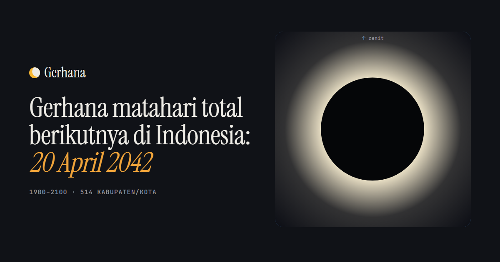

# Gerhana



**[Buka Gerhana](https://gerhana.raffstw.my.id)**

Setiap gerhana matahari yang terlihat dari Indonesia dari 1900 sampai 2100, dihitung untuk 514
kabupaten/kota. Ada 121 gerhana; 17 di antaranya melintaskan jalur total dan 19 jalur cincin.
Yang total berikutnya terjadi 20 April 2042.

- **Di daerahmu**: jam mulai, puncak, dan selesai dalam WIB/WITA/WIT, tinggi Matahari, lama fase
  total atau cincin, dan gambar Matahari serta Bulan seperti terlihat dari sana. Geser atau putar
  untuk melihat Bulan melintas.
- **Semua gerhana di satu daerah**: satu titik per gerhana, 1900–2100. Klik titik untuk
  membukanya.
- **Peta**: ketertutupan Matahari di setiap kabupaten/kota untuk gerhana yang dipilih, dengan
  jalur total dan cincin.
- **Jalur total dan cincin**: daftar gerhana yang jalurnya melintasi Indonesia beserta provinsi
  yang dilalui.

## Perhitungan

Semua posisi Matahari dan Bulan dihitung dengan
[Astronomy Engine](https://github.com/cosinekitty/astronomy) (Don Cross, MIT). `src/astro.ts`
berisi perhitungan untuk satu titik dan dipakai oleh halaman sekaligus skrip data.

`npm run data` mencari setiap gerhana matahari global 1900–2100, lalu menghitung keadaannya di titik
tengah 514 kabupaten/kota dan menyimpannya di `public/data/gerhana.json`. Butuh beberapa menit;
pekerjaannya dibagi ke beberapa worker. Skrip ini menjalankan TypeScript langsung, jadi perlu
Node 22.18 atau lebih baru.

Sebuah gerhana dihitung terlihat bila Matahari di atas ufuk saat gerhana mulai atau berakhir. Bila
puncaknya terjadi setelah Matahari terbenam atau sebelum terbit, peta memakai ketertutupan saat
Matahari terbenam atau terbit, bukan saat puncak. Jam ditulis dalam zona waktu sekarang, juga untuk
gerhana lampau.

Hasilnya diuji terhadap gerhana yang tercatat: total 9 Maret 2016 di Palu, cincin 26 Desember 2019
di Singkawang, dan total 11 Juni 1983 di Yogyakarta.

Batas wilayah: geoBoundaries ADM2 (CC BY 3.0 IGO).

> Jangan menatap Matahari tanpa kacamata gerhana berstandar ISO 12312-2, juga saat gerhana
> sebagian atau cincin.

## Menjalankan

```
npm install
npm run dev
npm test
npm run build
```
